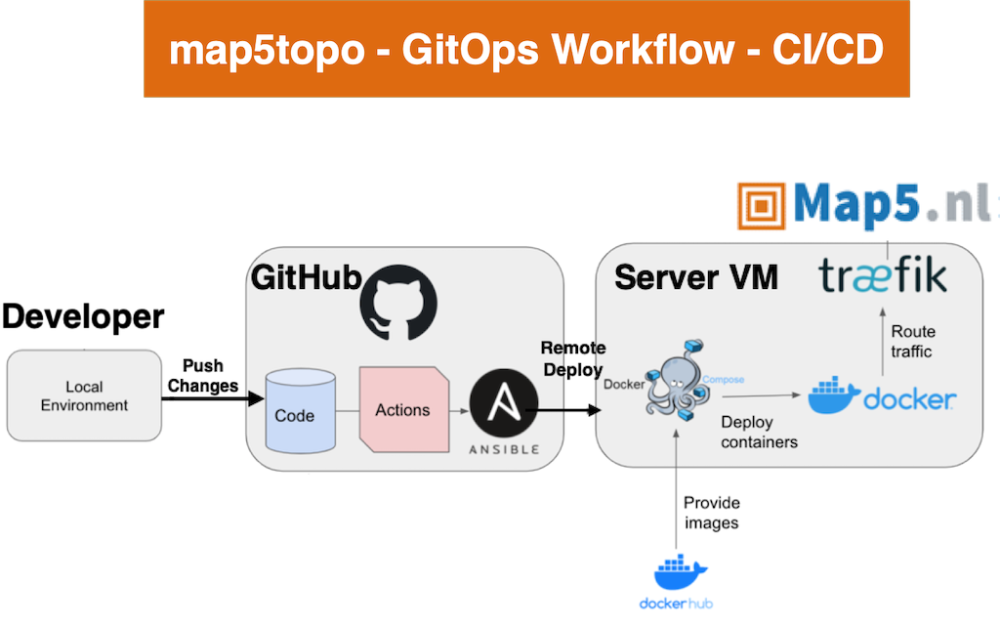

# Deployment

## Development
Development deployment follows a CI/CD pattern, called "GitOps". This is a continuous integration
where each commit/push to a Git(Hub) repository results in the deployment 
of a new version (of the affected components) within a remote development server.
The development server basically contains an uptodate mirror of the Git repositories.
These repos contain both the tools like ETL and Styles, but also the (web) services
to serve maps like MapProxy, databases (PostGIS), demos and more. 
Everything is maintained in Git, hence the term GitOps as a DevOps strategy.

<figure markdown>
{ data-title="deployment architecture" data-description="This depicts the deployment rchitecture" }
<figcaption>Deployment architecture</figcaption>
</figure>

This figure applies to the map5topo development CI/CD. The main flow is from left to right as follows:

* development (ETL, styling, demos etc) is done in a local environment (laptop/desktop)
* the resulting content (code, SQL, styles, demos,...) is pushed to GitHub
* within GitHub a workflow(s) specific to the component(s) is (are) triggered
* for each component a specific [Ansible](https://docs.ansible.com/) Playbook is invoked
* each Playbook will connect to the development server, pull-in changes from Git and (build) redeploy the component(s)
* all components run as Docker Containers, some custom locally built, most fetched from DockerHub

## Test and Production

A separate server infrastructure is used to deploy within the [map5.nl](https://map5.nl) test and production environment.
The main deployment processes involve the data ETL and tiling for raster (MapProxy) and vector (Martin), 
plus occasional DEM-based generation (hillshade, contours, elevation tiles).

The fullstack constellation is described in the [Architecture](architecture.md) chapter.
